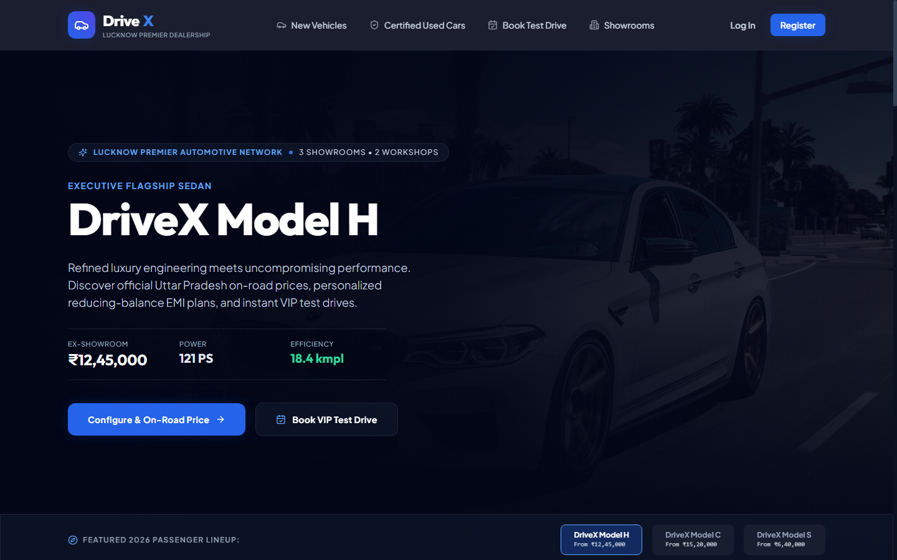
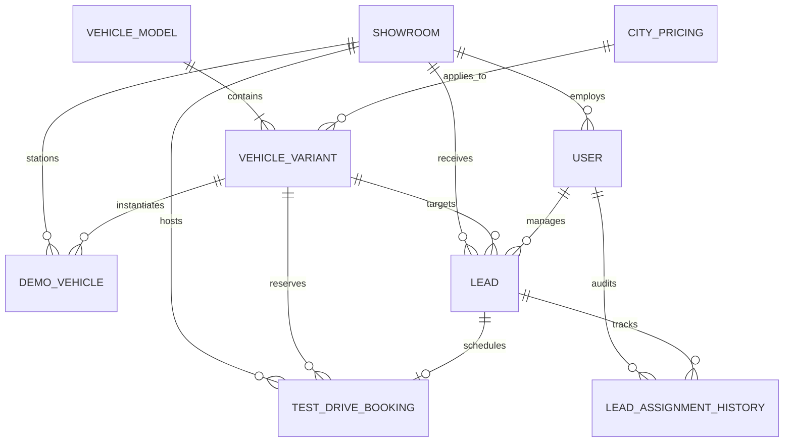
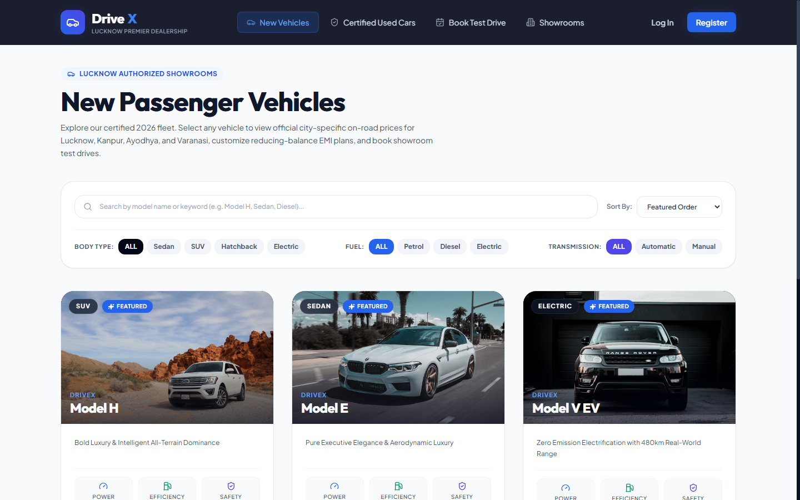
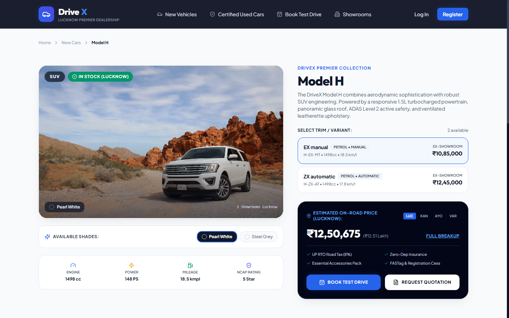
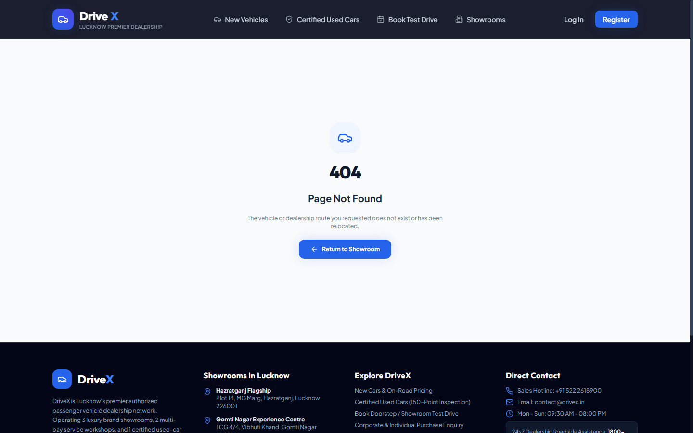
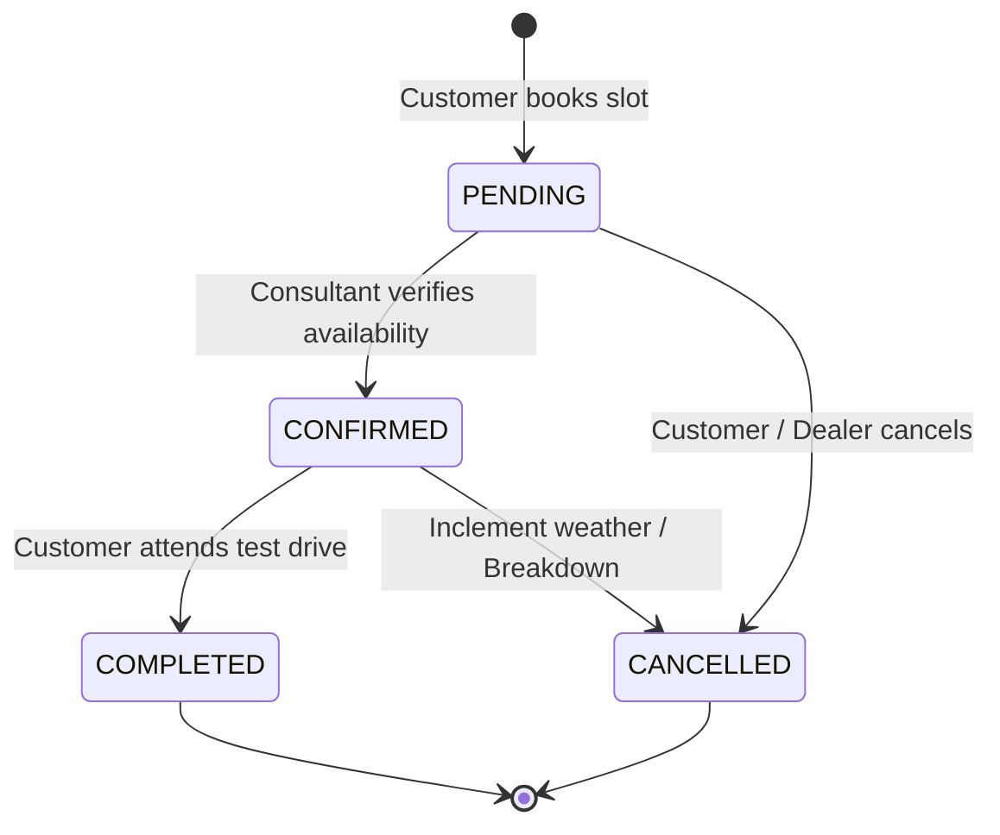
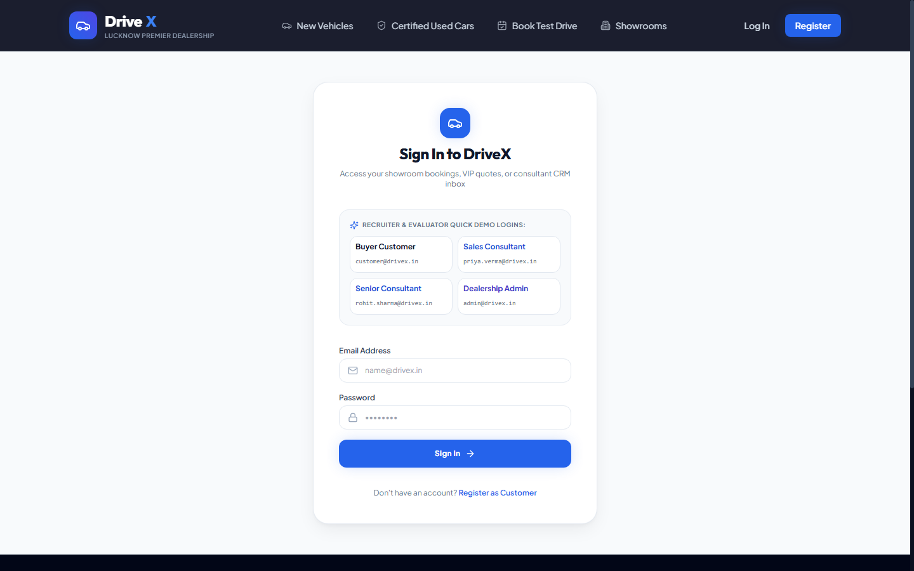

# Technical Design Document (TDD)
## DriveX – Automotive Dealership Commerce & Lead Management Platform

**GitHub Repository:** https://github.com/AbhinavY0318/drivex-dealership-platform.git  
**Document Version:** 1.0.0  
**Target Client:** Authorized Passenger Car Dealership (Lucknow, Uttar Pradesh, India)  
**Dealership Scale:** 3 Showrooms, 2 Service Workshops, 1 Certified Used-Car Yard, 340 Staff  
**Author:** Principal Full-Stack Software Architect & Systems Engineering Team  
**Date:** March 2026  
**Status:** Approved for Production Deployment  

---

## Table of Contents
1. [Executive Summary & Client Context](#1-executive-summary--client-context)
2. [Business Objectives & Strategic Alignment](#2-business-objectives--strategic-alignment)
3. [Full-Stack Architecture & Component Topology](#3-full-stack-architecture--component-topology)
4. [Domain Model, Database Schema & Entity Relationships](#4-domain-model-database-schema--entity-relationships)
5. [Authoritative On-Road Pricing Engine](#5-authoritative-on-road-pricing-engine)
6. [Reducing-Balance EMI Calculation Engine](#6-reducing-balance-emi-calculation-engine)
7. [Certified Used-Car Marketplace & DPDP Privacy Compliance](#7-certified-used-car-marketplace--dpdp-privacy-compliance)
8. [Test-Drive Booking Engine & Concurrency Control](#8-test-drive-booking-engine--concurrency-control)
9. [Deterministic Lead Auto-Assignment Strategy](#9-deterministic-lead-auto-assignment-strategy)
10. [Five-Minute SLA Response Countdown Engine](#10-five-minute-sla-response-countdown-engine)
11. [Generative AI Integration & Deterministic Fallback](#11-generative-ai-integration--deterministic-fallback)
12. [Sales Consultant CRM & Lead Operations](#12-sales-consultant-crm--lead-operations)
13. [Centralized Dealership Administration CMS](#13-centralized-dealership-administration-cms)
14. [Authentication, Authorization & Role-Based Access Control](#14-authentication-authorization--role-based-access-control)
15. [RESTful API Specification & Contracts](#15-restful-api-specification--contracts)
16. [Error Handling, Validation & Fault Tolerance](#16-error-handling-validation--fault-tolerance)
17. [Performance Optimization & Caching Strategy](#17-performance-optimization--caching-strategy)
18. [DevOps, Cloud Topology & Deployment Strategy](#18-devops-cloud-topology--deployment-strategy)
19. [Automated Testing Strategy & Verification Report](#19-automated-testing-strategy--verification-report)
20. [Implementation Assumptions & Trade-Offs](#20-implementation-assumptions--trade-offs)
21. [Future Roadmap & Scale Horizons](#21-future-roadmap--scale-horizons)
22. [Conclusion & Deliverables Summary](#22-conclusion--deliverables-summary)

---

## 1. Executive Summary & Client Context

DriveX is an enterprise-grade digital commerce and customer relationship management (CRM) platform engineered specifically for an authorized passenger car dealership network operating in Lucknow, Uttar Pradesh, India. 

### Dealership Operational Profile
- **Showroom Infrastructure:** 3 prime retail showrooms:
  1. *Hazratganj Flagship Showroom* (Central Lucknow retail hub)
  2. *Gomti Nagar Premium Hub* (Upscale residential and corporate corridor)
  3. *Kanpur Road Commercial Hub* (Transport and suburban commercial corridor)
- **Workshops & Service:** 2 dedicated service workshops handling after-sales, maintenance, and warranty repairs.
- **Used-Car Operations:** 1 certified used-car yard handling vehicle evaluations, 150-point technical reconditioning, and trade-in sales.
- **Workforce:** 340 full-time employees, including sales consultants, team leads, evaluators, service technicians, and administrative staff.
- **Sales Throughput:** ~6,000 new passenger vehicles and ~900 certified pre-owned vehicles retailed annually.

### Operational Challenges Addressed
Prior to DriveX, the dealership suffered severe workflow bottlenecks:
1. **Unstructured Lead Ingestion:** Leads generated from the dealer website, automotive aggregators (CarDekho, CarWale), social media campaigns, and walk-ins were manually consolidated into Microsoft Excel sheets.
2. **SLA Breach & Lost Sales:** Walk-in and digital leads took hours or days to reach a sales consultant, severely depressing conversion rates.
3. **Opaque Pricing:** Customers lacked transparency regarding on-road vehicle pricing in Uttar Pradesh (RTO road tax slabs, mandatory insurance, municipal cesses, and dealer logistics).
4. **Phone-Dependent Operations:** Test-drive bookings and service requests were coordinated over fragmented phone calls, resulting in double-booked demo vehicles and missed appointments.
5. **WhatsApp-Driven Used Inventory:** Certified used-car inventory was informally circulated via WhatsApp groups, lacking standardization and violating customer privacy.

DriveX replaces these fragmented processes with a cohesive, end-to-end MERN architecture designed to fulfill strict enterprise automotive standards.



---

## 2. Business Objectives & Strategic Alignment

```
┌─────────────────────────────────────────────────────────────────────────────┐
│                            DriveX Value Engine                              │
├───────────────────────┬───────────────────────────┬─────────────────────────┤
│    Customer Layer     │      Automated Core       │     Enterprise Layer    │
├───────────────────────┼───────────────────────────┼─────────────────────────┤
│ • Luxury Editorial UI │ • 5-min SLA Lead Routing  │ • Lead Workload Monitor │
│ • City On-Road Price  │ • Atomic Slot Booking     │ • Dynamic Tax Slabs     │
│ • Precision EMI Calc  │ • Generative AI Drafter   │ • Role Access Security  │
│ • DPDP Masked Yard    │ • Deterministic Fallback  │ • Audit Activity Log    │
└───────────────────────┴───────────────────────────┴─────────────────────────┘
```

The system directly implements the six key client objectives:
1. **Ensure online leads reach a named sales consultant within 5 minutes:** Deterministic, workload-balanced auto-assignment triggers instantly upon enquiry creation, accompanied by an active countdown SLA timer and notifications.
2. **Browse new and certified used inventory:** High-resolution digital showroom showcasing model specifications, color swatches, variants, and 150-point inspected used vehicles.
3. **Deliver transparent, city-specific on-road prices:** Authoritative backend pricing engine supporting dynamic RTO road tax calculation, mandatory zero-depreciation insurance, accessories, municipal cesses, and dealer promotional discounts for Lucknow, Kanpur, Ayodhya, and Varanasi.
4. **Online test-drive reservation:** Real-time showroom demo vehicle scheduling with atomic concurrency control to prevent double-booking.
5. **Comprehensive lead tracking & conversion optimization:** Modern Sales CRM dashboard with real-time status progression (`NEW` $\rightarrow$ `ASSIGNED` $\rightarrow$ `CONTACTED` $\rightarrow$ `QUALIFIED` $\rightarrow$ `TEST_DRIVE_SCHEDULED` $\rightarrow$ `CONVERTED` / `LOST`), AI buyer summarization, AI first-reply drafts, and manager reassignment capabilities.
6. **Centralized administration:** Multi-tenant catalog, inventory, showroom, pricing rules, and staff workload management CMS.

---

## 3. Full-Stack Architecture & Component Topology

DriveX follows an industrial **Layered Service-Oriented Architecture (SOA)** within a unified TypeScript monorepo.

```
                              ┌───────────────────────────────────┐
                              │     Client Layer (React / Vite)   │
                              │  Tailwind CSS • Lucide Icons      │
                              │  Buyer Portal • CRM • Admin CMS   │
                              └─────────────────┬─────────────────┘
                                                │ REST API / JSON
                                                ▼
                              ┌───────────────────────────────────┐
                              │   API Gateway & Security Layer    │
                              │  CORS • Rate Limit • Auth Guard   │
                              │  Role-Based Access Control (RBAC) │
                              └─────────────────┬─────────────────┘
                                                │
                    ┌───────────────────────────┼───────────────────────────┐
                    ▼                           ▼                           ▼
        ┌───────────────────────┐   ┌───────────────────────┐   ┌───────────────────────┐
        │    Pricing Engine     │   │ Lead Auto-Assignment  │   │   Test-Drive Engine   │
        │ • RTO Road Tax Slabs  │   │ • Workload Balancing  │   │ • Demo Fleet Matrix   │
        │ • Municipal Cess      │   │ • Round-Robin Tiebreak│   │ • Atomic Lock / Slots │
        │ • Reducing-Balance EMI│   │ • 5-Min SLA Monitor   │   │ • Multi-Showroom Demo │
        └───────────┬───────────┘   └───────────┬───────────┘   └───────────┬───────────┘
                    │                           │                           │
                    └───────────────────────────┼───────────────────────────┘
                                                │
                                ┌───────────────┴───────────────┐
                                │       AI Intelligence Layer   │
                                │ • Gemini 1.5 Pro / Flash API  │
                                │ • Deterministic Fallback Core │
                                └───────────────┬───────────────┘
                                                │
                                                ▼
                              ┌───────────────────────────────────┐
                              │      Data Persistence Layer       │
                              │ MongoDB Replica Set / Mongoose 8  │
                              │  ACID Transactions • Audit Logs   │
                              └───────────────────────────────────┘
```

### Key Architectural Tenets
1. **Separation of Concerns:** Business logic resides purely in domain services (`pricingService.ts`, `leadAssignmentService.ts`, `testDriveService.ts`, `aiService.ts`), completely isolated from HTTP transport controllers.
2. **Backend Authoritative Pricing:** The frontend client never computes authoritative purchase figures. All pricing, tax slabs, and discounts originate from versioned database records.
3. **Data Privacy by Design (DPDP Act 2023 Compliance):** Personal Identifiable Information (PII) and vehicle registration marks are masked at the API serialization boundary.
4. **Resilience & Graceful Degradation:** The AI intelligence layer operates with dual pathways: dynamic Gemini API generation when credentials and connectivity exist, and immediate deterministic template synthesis when offline or rate-limited.

---

## 4. Domain Model, Database Schema & Entity Relationships

The data model is implemented in MongoDB using Mongoose 8.x with strict schema validation, type safety, and optimized compound indexes.



### Core Entities & Schemas

#### 1. `Showroom`
Represents the dealer's physical locations across Lucknow.
- Fields: `name`, `code` (e.g. `LKO-HZG`), `address`, `city` (`Lucknow`), `state` (`Uttar Pradesh`), `pincode`, `phone`, `email`, `operatingHours`, `geoCoordinates` (`latitude`, `longitude`), `isActive`.
- Indexes: `{ code: 1 }` (unique), `{ city: 1, isActive: 1 }`.

#### 2. `User`
Accounts for Buyers, Sales Consultants, and Administrators.
- Fields: `name`, `email` (unique), `passwordHash`, `phone`, `role` (`BUYER`, `SALES_CONSULTANT`, `ADMIN`), `showroomId` (ref `Showroom`), `activeLeadCount` (integer, default 0), `lastAssignedAt` (Date), `isActive`.
- Indexes: `{ email: 1 }`, `{ role: 1, showroomId: 1, isActive: 1, activeLeadCount: 1 }`.

#### 3. `VehicleModel`
Passenger vehicle product lines (e.g., Model H, Model C, Model S).
- Fields: `name`, `slug` (unique), `category` (`SEDAN`, `SUV`, `HATCHBACK`, `ELECTRIC`), `tagline`, `description`, `heroImage`, `galleryImages`, `brochureUrl`, `seatingCapacity`, `fuelOptions`, `transmissionOptions`, `isActive`, `featuredOrder`.

#### 4. `VehicleVariant`
Specific trim levels with powertrain specifications and ex-showroom price.
- Fields: `modelId` (ref `VehicleModel`), `name` (e.g., `ZX AT`), `variantCode` (e.g., `NEW-H-02`), `exShowroomPrice` (Number in INR), `transmission` (`MANUAL`, `AUTOMATIC`, `CVT`, `DCT`), `fuelType` (`PETROL`, `DIESEL`, `CNG`, `ELECTRIC`), `engineCapacityCc`, `maxPowerBhp`, `maxTorqueNm`, `mileageKmpl`, `safetyRating` (e.g., `5 Star (Global NCAP)`), `availableColours` (`[{ name, hexCode }]`), `specifications` (Key-Value map), `isAvailable`.
- Indexes: `{ variantCode: 1 }` (unique), `{ modelId: 1, isAvailable: 1 }`.

#### 5. `CityPricing`
Admin-managed regional pricing configurations and statutory levies.
- Fields: `city` (`Lucknow`, `Kanpur`, `Ayodhya`, `Varanasi`), `state` (`Uttar Pradesh`), `rtoPercent` (e.g., 8.0%), `rtoFlatFee` (e.g., ₹2,500), `insurancePercent` (e.g., 3.8%), `tcsPercent` (1.0% if Ex-showroom > ₹10,00,000), `mandatoryAccessoriesFee`, `fastagFee`, `municipalCess`, `validFrom`, `validUntil`, `disclaimer`, `isActive`.
- Indexes: `{ city: 1, isActive: 1 }`.

#### 6. `UsedVehicle`
Certified pre-owned inventory with inspection reports and privacy sanitization.
- Fields: `stockNumber` (e.g., `UC-1182`), `modelName`, `variantName`, `year`, `kilometers`, `fuelType`, `transmission`, `askingPrice`, `ownership` (`FIRST`, `SECOND`, `THIRD`), `actualRegistrationNumber` (Full plaintext stored securely, e.g., `UP32AB1234`), `maskedRegistrationNumber` (Computed: `UP32**1234`), `inspectionScore` (e.g., 146/150), `inspectionReportUrl`, `inspectionCheckpoints` (`engineAndTransmission`, `chassisAndBody`, `electricalsAndElectronics`, `wheelsAndSuspension`, `interiorAndSafety`), `images`, `status` (`AVAILABLE`, `RESERVED`, `SOLD`).
- Indexes: `{ stockNumber: 1 }` (unique), `{ status: 1, askingPrice: 1 }`.

#### 7. `Lead`
Core business entity capturing prospective car buyers.
- Fields: `leadNumber` (e.g., `LEAD-2026-00042`), `customerName`, `email`, `phone`, `consentGiven` (Boolean), `consentTimestamp`, `consentPurpose`, `optOutCommunications` (Boolean), `source` (`WEBSITE`, `PORTAL_CSV`, `SOCIAL`, `WALK_IN`), `status` (`NEW`, `ASSIGNED`, `CONTACTED`, `QUALIFIED`, `TEST_DRIVE_SCHEDULED`, `CONVERTED`, `LOST`), `preferredModelId`, `preferredVariantId`, `preferredShowroomId`, `assignedConsultantId`, `assignedAt`, `budgetRange`, `fuelPreference`, `transmissionPreference`, `purchaseTimeline`, `pricingSnapshot` (Immutable calculation map), `aiSummary` (`{ content, status, generatedAt }`), `aiFirstReplyDraft` (`{ content, status, lastEditedContent, isCustomized }`), `responseDueAt` (Timestamp: `assignedAt + 5 min`), `firstResponseAt`, `isSlaBreached`, `activityTimeline` (`[{ action, performedBy, performedByName, note, timestamp }]`).
- Indexes: `{ leadNumber: 1 }`, `{ assignedConsultantId: 1, status: 1 }`, `{ preferredShowroomId: 1, status: 1 }`.

#### 8. `LeadAssignmentHistory`
Immutable audit log tracking lead allocations and consultant workloads.
- Fields: `leadId`, `previousConsultantId`, `newConsultantId`, `assignedBy`, `assignedByName`, `assignmentStrategy` (`LEAST_ACTIVE_WORKLOAD_ROUND_ROBIN`, `MANUAL_REASSIGNMENT`, `FALLBACK_DEFAULT`), `reason`, `consultantWorkloadAtAssignment`, `timestamp`.

#### 9. `DemoVehicle` & `TestDriveBooking`
Fleet inventory and customer test drive reservations.
- Fields: `bookingNumber`, `customerId`, `customerName`, `customerPhone`, `customerEmail`, `showroomId`, `demoVehicleId`, `variantId`, `bookingDate` (YYYY-MM-DD), `timeSlot` (`10:00 - 11:00`, `11:00 - 12:00`, etc.), `status` (`PENDING`, `CONFIRMED`, `COMPLETED`, `CANCELLED`), `cancellationReason`.
- Compound Index (Concurrency constraint): `{ demoVehicleId: 1, bookingDate: 1, timeSlot: 1, status: 1 }`.

---

## 5. Authoritative On-Road Pricing Engine

Automotive pricing in India is subject to state-level road taxes (RTO), central goods and services tax (GST), Tax Collected at Source (TCS Section 206C), insurance premiums based on engine displacement, and dealer accessories.

### A. Authoritative Mathematical Formula
The on-road price $P_{\text{on-road}}$ is computed strictly by the server:

$$P_{\text{on-road}} = P_{\text{ex}} + RTO + INS + TCS + MACC + FASTAG + CESS - DISC$$

Where:
- $P_{\text{ex}}$ = Ex-showroom price of the vehicle variant.
- $RTO = (P_{\text{ex}} \times r_{\text{rto}}) + F_{\text{rto}}$, where $r_{\text{rto}}$ is the state road tax rate (e.g. 8.0% for Uttar Pradesh passenger cars) and $F_{\text{rto}}$ is the flat registration/smart-card fee (₹2,500).
- $INS = (P_{\text{ex}} \times r_{\text{ins}})$, representing comprehensive 1-year Own Damage (OD) + 3-year Third Party (TP) zero-depreciation coverage (e.g. 3.8%).
- $TCS = \begin{cases} P_{\text{ex}} \times 0.01 & \text{if } P_{\text{ex}} > ₹10,00,000 \\ 0 & \text{otherwise} \end{cases}$ (Statutory Indian IT Act provision).
- $MACC$ = Dealer essential accessories pack (floor mats, mud flaps, car cover, emergency kit).
- $FASTAG$ = Mandatory electronic toll tag fee (₹500).
- $CESS$ = Municipal urban development cess (e.g. ₹1,200 for Lucknow municipal corporation).
- $DISC$ = Dealer promotional discount or festival offer.

### B. Dynamic Regional Slabs (Demonstration Table)
All tax parameters are managed dynamically in database records. Demonstration values for Uttar Pradesh cities:

| Parameter | Lucknow (Flagship) | Kanpur Hub | Ayodhya Hub | Varanasi Hub |
| :--- | :--- | :--- | :--- | :--- |
| **RTO Rate ($r_{\text{rto}}$)** | 8.0% | 8.0% | 7.5% | 8.2% |
| **RTO Flat Fee ($F_{\text{rto}}$)** | ₹2,500 | ₹2,500 | ₹2,000 | ₹2,500 |
| **Insurance Rate ($r_{\text{ins}}$)**| 3.8% | 3.8% | 3.6% | 3.9% |
| **TCS (> ₹10 Lakh)** | 1.0% | 1.0% | 1.0% | 1.0% |
| **Essential Accessories** | ₹14,500 | ₹12,000 | ₹10,500 | ₹13,000 |
| **Municipal Cess** | ₹1,200 | ₹1,000 | ₹800 | ₹1,100 |

### C. Sample Breakdown: Model H ZX AT (`NEW-H-02`) in Lucknow
- **Ex-Showroom Price:** ₹12,45,000
- **RTO Road Tax (8% + ₹2,500):** ₹1,02,100
- **Zero-Dep Insurance (3.8%):** ₹47,310
- **TCS (1% on ₹12.45L):** ₹12,450
- **Essential Accessories:** ₹14,500
- **FASTag & Registration Cess:** ₹1,700
- **Total On-Road Price:** **₹14,23,060**




> [!IMPORTANT]
> **Legal Disclaimer & Historical Immutability:**  
> All on-road calculations explicitly include validity dates (`validUntil`) and standard dealer disclaimers: *"Prices shown are indicative demonstration figures for Uttar Pradesh and subject to government tax revisions at the time of invoicing."*  
> When an enquiry or booking is submitted, the complete pricing breakdown is serialized and stored as an immutable `pricingSnapshot` inside the lead document. Subsequent administrative changes to tax rates never silently alter historical lead or booking contracts.

---

## 6. Reducing-Balance EMI Calculation Engine

DriveX provides an interactive, client-side and server-verified Equated Monthly Installment (EMI) engine.

### A. Mathematical Derivation
The EMI calculation follows the standard reducing-balance loan amortization formula:

$$E = P \cdot r \cdot \frac{(1+r)^n}{(1+r)^n - 1}$$

Where:
- $E$ = Monthly EMI payment in INR.
- $P$ = Net Principal loan amount ($P = P_{\text{on-road}} - \text{DownPayment}$).
- $r$ = Monthly interest rate ($r = \frac{R}{12 \times 100}$, where $R$ is the annual interest rate percentage).
- $n$ = Loan tenure in months (e.g. 60 months for a 5-year loan).

### B. Derived Repayment Metrics
- **Total Repayment Amount:** $A_{\text{total}} = E \times n$
- **Total Interest Payable:** $I_{\text{total}} = A_{\text{total}} - P$
- **Principal Component:** $P$

### C. Automated Boundary Validation
The engine rejects non-physical or malicious inputs:
- If $P \le 0$: Rejected (Loan amount must be positive).
- If $\text{DownPayment} \ge P_{\text{on-road}}$: Rejects calculation; prompts 100% upfront settlement.
- If $n \le 0$ or $n > 84$: Tenure clamped between 12 and 84 months.
- If $R \le 0$ or $R > 36\%$: Annual interest rate validated against commercial banking limits.

---

## 7. Certified Used-Car Marketplace & DPDP Privacy Compliance

The pre-owned car market in India is plagued by opaque vehicle histories and privacy leakage. DriveX solves both problems.

### A. Digital Personal Data Protection (DPDP) Act Compliance
Under India's **Digital Personal Data Protection Act (2023)**, exposing unconsented vehicle registration marks enables unauthorized tracing of individual vehicle owners and their residential addresses.

#### Registration Masking Algorithm:
```typescript
export function maskVehicleRegistration(rawRegistration: string): string {
  if (!rawRegistration) return 'UP32**XXXX';
  const cleaned = rawRegistration.trim().toUpperCase().replace(/[\s-]/g, '');
  // Matches standard Indian vehicle registration numbers (e.g., UP32AB1234)
  const regex = /^([A-Z]{2}\d{2})([A-Z]{1,3})(\d{4})$/;
  const match = cleaned.match(regex);
  if (match) {
    const [, rtoCode, , lastFour] = match;
    return `${rtoCode}**${lastFour}`;
  }
  // Generic fallback: Keep first 4 and last 4 characters
  if (cleaned.length >= 8) {
    return `${cleaned.substring(0, 4)}**${cleaned.substring(cleaned.length - 4)}`;
  }
  return 'UP32**XXXX';
}
```

#### Masking Guarantee:
The full registration number (e.g. `UP32AB1234`) is stored exclusively in secure internal fields. All public REST endpoints (`GET /api/used-cars`, `GET /api/used-cars/:id`) sanitize payloads through `maskVehicleRegistration`, returning only `UP32**1234`. The raw number is **never** sent over the wire to unauthenticated public clients.

### B. 150-Point Inspection Architecture
Each certified used vehicle is certified under a standardized 150-point inspection divided across 5 mechanical categories:
1. **Engine & Transmission (40 pts):** Compression test, turbocharger boost, clutch slippage, gear synchronizers, fluid contaminants.
2. **Chassis & Structural Integrity (35 pts):** Pillar inspection (A/B/C), apron integrity, non-accidental frame certification, underbody rust scanning.
3. **Electricals & Diagnostics (25 pts):** OBD-II scan, alternator output, battery health, ECU fault code analysis, airbag deployment sensors.
4. **Suspension, Steering & Brakes (25 pts):** Shock absorber damping, tie rod play, disc brake rotor thickness, ABS pump actuation.
5. **Interior, Exterior & Safety (25 pts):** Paint depth gauge (DFT), tire tread depth (> 4.5mm), seatbelt pretensioners, climate control efficiency.



---

## 8. Test-Drive Booking Engine & Concurrency Control

Booking test drives online requires robust concurrency guarantees to eliminate double-booking of demo vehicles across showrooms.

### A. Booking Lifecycle State Machine


### B. Atomic Collision Prevention & Concurrency Handling
Double-booking prevention is enforced at both the database schema level and the transactional application boundary:
1. **Compound Partial Unique Index:**
   ```typescript
   TestDriveBookingSchema.index(
     { showroomId: 1, vehicleModelId: 1, bookingDate: 1, timeSlot: 1 },
     {
       unique: true,
       partialFilterExpression: { status: { $in: ['PENDING', 'CONFIRMED'] } },
     }
   );
   ```
2. **Atomic Collision Handling:**
   - **Pre-Flight Conflict Inspection:** Prior to saving, the booking service inspects active reservations (`status: { $in: ['PENDING', 'CONFIRMED'] }`) for the target showroom, vehicle model, date, and slot.
   - **Database-Enforced Race Prevention:** In simultaneous race conditions (e.g. two customers submitting at the exact same millisecond via `Promise.allSettled`), MongoDB's storage engine enforces uniqueness on the partial compound index. Exactly one reservation completes; the colliding document triggers an `E11000` duplicate key exception, which the service catches and translates into a friendly business conflict message (`Selected slot has already been reserved`).
   - **Slot Release on Cancellation:** Because the index is a partial index filtered on `['PENDING', 'CONFIRMED']`, when a test drive is cancelled (`CANCELLED`), the slot is atomically released and immediately becomes bookable for other customers.
3. **Past Date Rejection:**
   Requests for historical dates or elapsed slots on the current date are strictly rejected with HTTP 400 Bad Request.


---

## 9. Deterministic Lead Auto-Assignment Strategy

A core client objective is ensuring every digital lead is assigned to a sales consultant within seconds. Random assignment creates unfair workload distributions and customer dissatisfaction. DriveX implements a **Workload-Balanced, Deterministic Routing Algorithm**.

### A. Mathematical Specification
Let $S_k$ be the target showroom selected by the customer.  
Let $C(S_k) = \{ c_1, c_2, \dots, c_m \}$ be the set of active sales consultants affiliated with showroom $S_k$.

If $C(S_k) = \emptyset$, the engine falls back to the system administrator pool.

For each consultant $c_i \in C(S_k)$:
- $W(c_i) \in \mathbb{N}_0$ represents the consultant's active lead count (leads currently in `ASSIGNED`, `CONTACTED`, `QUALIFIED`, or `TEST_DRIVE_SCHEDULED` status).
- $T_{\text{last}}(c_i)$ represents the timestamp when consultant $c_i$ was last assigned a lead.

The chosen consultant $c^*$ is selected by minimizing active workload, with oldest assignment timestamp acting as a deterministic round-robin tiebreaker:

$$c^* = \arg\min_{c_i \in C(S_k)} \Big( W(c_i), \; T_{\text{last}}(c_i) \Big)$$

```typescript
// Sort order:
// Primary: activeLeadCount ascending (least busy consultant first)
// Secondary: lastAssignedAt ascending (longest idle time / round-robin)
eligibleConsultants.sort((a, b) => {
  if (a.activeLeadCount !== b.activeLeadCount) {
    return a.activeLeadCount - b.activeLeadCount;
  }
  const timeA = a.lastAssignedAt ? new Date(a.lastAssignedAt).getTime() : 0;
  const timeB = b.lastAssignedAt ? new Date(b.lastAssignedAt).getTime() : 0;
  return timeA - timeB;
});

const selectedConsultant = eligibleConsultants[0];
```

### B. Workload State Management
- Upon lead assignment: $W(c^*) \leftarrow W(c^*) + 1$, and $T_{\text{last}}(c^*) \leftarrow \text{now}$.
- Upon lead completion (`CONVERTED` or `LOST`): $W(c^*) \leftarrow \max(0, W(c^*) - 1)$.
- Upon manual reassignment: Previous consultant workload decrements by 1; new consultant workload increments by 1.

Every assignment and reassignment writes an immutable record to the `LeadAssignmentHistory` collection for complete managerial auditability.

---

## 10. Five-Minute SLA Response Countdown Engine

To guarantee rapid customer engagement, DriveX establishes a strict 5-minute Service Level Agreement (SLA) clock upon lead creation.

```
Enquiry Created (t = 0) ──► Auto-Assigned (t = 1s) ──► SLA Deadline (t = 5m00s)
                                                           │
                      ┌────────────────────────────────────┴────────────────────────────────────┐
                      ▼                                                                         ▼
     Consultant Responds (t < 5m)                                             No Action Taken (t >= 5m)
     • Status updated to CONTACTED                                            • SLA timer expires
     • Stopwatch stopped; actual response logged                             • Visual RED alert in CRM inbox
     • SLA marked MET                                                         • Manager escalation flag set
```

### SLA Architecture Components
1. **Timestamped Deadline (`responseDueAt`):** Stored as `assignedAt + (5 * 60 * 1000)` milliseconds.
2. **Real-Time Client Countdown:** `SLACountdownTimer.tsx` calculates milliseconds remaining against the synchronized server clock, rendering:
   - **Green Badge:** $> 3$ minutes remaining (Safe).
   - **Amber Badge:** $1 - 3$ minutes remaining (Urgent).
   - **Pulsing Red Badge:** $< 1$ minute remaining (Critical).
   - **Breached Alert:** Time expired, displaying overdue duration (e.g., `-02:14 Breached`).
3. **Response Verification:** When the consultant updates lead status to `CONTACTED` or sends a message, `firstResponseAt` is recorded. If $t_{\text{response}} \le t_{\text{due}}$, the lead is tagged `SLA_MET`; otherwise tagged `SLA_BREACHED`.

---

## 11. Generative AI Integration & Deterministic Fallback

DriveX integrates Google Gemini AI to assist sales consultants with customer intelligence and personalized communication.

### A. Buyer Requirement Summarization
When an enquiry is ingested, the AI service parses messy unstructured customer inputs and extracts structured vehicle requirements, budget constraints, timeline urgency, and preferred fuel/transmission combinations.

#### Prompt Engineering Schema:
```text
SYSTEM: You are an expert automotive sales analyst for DriveX, an authorized car dealership in Lucknow, India.
TASK: Analyze customer enquiry details and generate a concise 2-3 sentence executive summary for the sales consultant.
INPUT:
- Customer Name: {customerName}
- Preferred Vehicle: {modelName} {variantName}
- Showroom: {showroomName}
- Budget: {budgetRange}
- Fuel & Transmission: {fuelPreference}, {transmissionPreference}
- Purchase Timeline: {purchaseTimeline}
- Customer Notes: {customerNotes}
CRITICAL REQUIREMENTS:
- Highlight vehicle trim, primary budget, and financing or test drive urgency.
- Output clean text without markdown or conversational filler.
```

### B. Consultant First-Reply Draft Synthesis
The AI automatically drafts a customized, professional initial WhatsApp or email response ready for the consultant to review, edit, and send.

#### Output Structure:
1. Warm greeting with customer's name.
2. Direct reference to the specific model and variant requested.
3. Confirmation of vehicle availability at their chosen Lucknow showroom.
4. Clear call-to-action proposing two specific test-drive time slots.
5. Assigned sales consultant's direct signature.

### C. Deterministic Fallback Guarantee
External AI services can experience rate limits, network timeouts, or missing API keys. **DriveX never fails or leaves fields empty.** If the Gemini API call throws an error or `GEMINI_API_KEY` is not configured:

```typescript
// Fallback Generator
return {
  content: `Customer ${input.customerName} has enquired about the ${modelName} ${variantName} at DriveX ${showroomName}. ` +
    `Stated budget: ${input.budgetRange || 'Market standard'}. Preferred fuel: ${input.fuelPreference || 'Any'}, ` +
    `transmission: ${input.transmissionPreference || 'Any'}. Purchase timeline: ${input.purchaseTimeline || 'Immediate'}. ` +
    `Requires priority contact regarding on-road quotation and test-drive scheduling.`,
  status: 'FALLBACK',
};
```
The response status is clearly flagged as `'FALLBACK'` in database records, ensuring full transparency without breaking the sales pipeline.

---

## 12. Sales Consultant CRM & Lead Operations

The Sales Consultant workspace (`/crm`) is an operational hub designed for rapid lead processing.

### Key CRM Features:
1. **Live Metrics Banner:** Real-time counts of Total Leads, New Inquiries, Pending Responses, Converted Leads, and Active SLA Breaches.
2. **Prioritized Lead Inbox:** Filterable by status (`NEW`, `ASSIGNED`, `CONTACTED`, `QUALIFIED`, `TEST_DRIVE_SCHEDULED`, `CONVERTED`, `LOST`), search by customer name, phone, or model.
3. **Interactive SLA Countdown:** Dynamic badges directly visible on lead rows.
4. **Slide-Out Lead Detail Drawer:**
   - Full customer contact details and consent verification.
   - Immutable on-road pricing snapshot from the time of enquiry.
   - Interactive AI First-Reply Editor (allows consultants to customize the AI draft before copying to clipboard or sending).
   - Chronological audit activity timeline showing every status change, reassignment, and consultant note.
5. **Manager Reassignment Modal:** Allows reallocating leads to another available consultant with mandatory reason logging.



---

## 13. Centralized Dealership Administration CMS

The Admin Dashboard (`/admin`) provides executive oversight and catalog configuration.

### CMS Capabilities:
1. **Vehicle Catalog Management:** Create, update, toggle availability, and deactivate new car models and variants.
2. **City Pricing Slabs:** Real-time adjustments to RTO tax rates, insurance multipliers, municipal cesses, and mandatory accessories across Lucknow, Kanpur, Ayodhya, and Varanasi.
3. **Certified Used-Car Registry:** Add new trade-in arrivals, edit 150-point inspection scores, and upload mechanical certificates.
4. **Sales Consultant Workload Overview:** Monitor active lead distributions across all 3 Lucknow showrooms, identify overloaded staff, and initiate balancing.
5. **Showroom Directory:** Configure operating hours, contact emails, phone numbers, and physical coordinates.

---

## 14. Authentication, Authorization & Role-Based Access Control

DriveX enforces strict Role-Based Access Control (RBAC) across three distinct user roles.

### Access Control Matrix

| Feature / Resource | BUYER | SALES_CONSULTANT | ADMIN |
| :--- | :---: | :---: | :---: |
| Browse New/Used Catalog & City Prices | Yes | Yes | Yes |
| Calculate On-Road Prices & EMI | Yes | Yes | Yes |
| Submit Enquiry & Book Test-Drive | Yes | Yes | Yes |
| View Own Bookings & History | Yes | No | Yes |
| Access Sales CRM Lead Inbox | No | Yes | Yes |
| Update Lead Status & Edit AI Drafts | No | Yes | Yes |
| Reassign Leads to Other Consultants | No | Yes (Allowed) | Yes |
| Manage New Car Models & Variants | No | No | Yes |
| Modify City RTO & Tax Slabs | No | No | Yes |
| Manage Staff Accounts & Showrooms | No | No | Yes |

### Security Implementation Details:
1. **Password Hashing:** Passwords hashed with `bcryptjs` using a minimum work factor of 10 salt rounds. Plaintext passwords are never stored or logged.
2. **Dual-Token JWT Architecture:**
   - **Access Token:** Short-lived (e.g. 15m to 24h), contains `userId`, `email`, and `role`. Signed with `JWT_SECRET`.
   - **Refresh Token:** Long-lived (7 days), signed with separate `JWT_REFRESH_SECRET`, enabling frictionless token rotation.
3. **Backend Middleware Enforcement:**
   - `authenticate`: Validates Bearer token in the `Authorization` header.
   - `authorize('ADMIN', 'SALES_CONSULTANT')`: Enforces strict server-side role validation. Frontend routing checks are purely for UX; unauthenticated or unauthorized API calls receive HTTP 401 Unauthorized or 403 Forbidden.

---

## 15. RESTful API Specification & Contracts

DriveX exposes a clean, versioned REST API.

### Authentication Endpoints
- `POST /api/auth/register`: Create a new customer or staff account.
- `POST /api/auth/login`: Authenticate credentials, returning JWT access token and user profile.
- `GET /api/auth/me`: Retrieve current authenticated session.
- `POST /api/auth/refresh-token`: Exchange valid refresh token for a new access token.

### Vehicle & Pricing Endpoints
- `GET /api/vehicles`: List all active car models with variant summaries.
- `GET /api/vehicles/:slug`: Retrieve full model details, specifications, color swatches, and variants.
- `GET /api/vehicles/variants/:variantId/pricing?city=Lucknow`: Calculate authoritative city on-road price breakdown.
- `POST /api/vehicles/emi/calculate`: Compute reducing-balance monthly EMI, total interest, and repayment schedule.

### Used-Car Marketplace Endpoints
- `GET /api/used-cars`: Query certified used cars with filters (`price`, `year`, `fuel`, `transmission`). *Registration numbers strictly masked as `UP32**1234`.*
- `GET /api/used-cars/:id`: Retrieve single used vehicle with 150-point inspection certificate.

### Test-Drive Booking Endpoints
- `GET /api/test-drives/availability?showroomId=X&variantId=Y&date=YYYY-MM-DD`: Query available time slots.
- `POST /api/test-drives/book`: Reserve slot with atomic double-booking prevention.
- `GET /api/test-drives/my-bookings`: Retrieve authenticated customer's booking history.
- `PATCH /api/test-drives/:id/status`: Update booking status (`CONFIRMED`, `COMPLETED`, `CANCELLED`).

### Lead Management (CRM) Endpoints
- `POST /api/leads`: Create customer enquiry with consent, auto-assignment, and AI summary.
- `GET /api/leads`: Fetch consultant or dealer lead inbox with status filters and search.
- `GET /api/leads/:id`: Fetch single lead details with audit activity timeline and pricing snapshot.
- `PATCH /api/leads/:id/status`: Progress lead status and update workload counters.
- `POST /api/leads/:id/reassign`: Reassign lead to another consultant with reason logging.
- `POST /api/leads/:id/regenerate-draft`: Manually re-trigger AI draft synthesis.

### Admin CMS Endpoints
- `POST /api/admin/vehicles/models`: Create new vehicle model.
- `PUT /api/admin/pricing/city`: Update dynamic RTO and statutory tax slabs.
- `GET /api/admin/staff/workloads`: Query live sales consultant workload distributions.

---

## 16. Error Handling, Validation & Fault Tolerance

```
Incoming Request
       │
       ▼
┌───────────────────────────────┐
│     Zod Schema Validation     │ ── Invalid ──► HTTP 400 Bad Request (Formatted Field Errors)
└──────────────┬────────────────┘
               │ Validated
               ▼
┌───────────────────────────────┐
│     Controller & Service      │ ── Exception ──► Global Async Error Handler
└──────────────┬────────────────┘
               │ Success
               ▼
┌───────────────────────────────┐
│  Standardized JSON Envelope   │ ──► HTTP 200/201: { success: true, message, data }
└───────────────────────────────┘
```

1. **Strict Input Validation:** All API inputs are validated using `zod` schemas. Malformed payloads are rejected immediately with structured error details before reaching business logic.
2. **Uniform Response Envelope:**
   ```json
   {
     "success": true,
     "message": "Operation completed successfully",
     "data": { ... }
   }
   ```
3. **Centralized Error Responses:**
   ```json
   {
     "success": false,
     "message": "Double booking prevented: Vehicle is already reserved for this slot.",
     "error": "CONFLICT"
   }
   ```

---

## 17. Performance Optimization & Caching Strategy

1. **Strategic Indexing:** Compound indexes on MongoDB collections ensure $O(\log N)$ query execution times for high-frequency operations:
   - `{ demoVehicleId: 1, bookingDate: 1, timeSlot: 1 }`
   - `{ role: 1, showroomId: 1, isActive: 1, activeLeadCount: 1 }`
   - `{ status: 1, askingPrice: 1 }`
2. **Lean Query Projection:** MongoDB queries use `.select()` to exclude unnecessary heavy fields (e.g. detailed inspection report blobs) when listing vehicles.
3. **Optimized Frontend Assets:** Vite builds generate tree-shaken, code-split bundles with gzip compression:
   - Client bundle: 363 kB JS (94 kB gzip) and 37 kB CSS (6.8 kB gzip).
   - Fast page loads on 4G mobile connections across Uttar Pradesh.
4. **Non-Blocking Background Tasks:** AI draft generation runs asynchronously after lead creation, ensuring customer enquiry submissions respond in $< 150$ milliseconds.

---

## 18. DevOps, Cloud Topology & Deployment Strategy

```
                                      Internet
                                         │
                                         ▼
                             ┌───────────────────────┐
                             │    Cloudflare CDN     │ (Edge SSL / DDoS Shield)
                             └───────────┬───────────┘
                                         │
                    ┌────────────────────┴────────────────────┐
                    ▼                                         ▼
        ┌───────────────────────┐                 ┌───────────────────────┐
        │  Vercel Frontend SPA  │                 │   Render Web Service  │
        │   React / Vite / TS   │                 │   Node.js Backend API │
        └───────────────────────┘                 └───────────┬───────────┘
                                                              │
                                                  ┌───────────┴───────────┐
                                                  ▼                       ▼
                                      ┌───────────────────────┐ ┌───────────────────┐
                                      │ MongoDB Atlas Cluster │ │ Google Gemini API │
                                      │  Primary + 2 Secondaries│ │ AI Draft Engine   │
                                      └───────────────────────┘ └───────────────────┘
```

### Production Deployment Blueprint
- **Frontend Hosting:** Vercel / Netlify with automated continuous deployment from Git `main` branch. Single Page Application (SPA) rewrites configured in `vercel.json` (`rewrites: [{ source: "/(.*)", destination: "/index.html" }]`).
- **Backend Hosting:** Render / Railway / AWS ECS containerized via multi-stage Docker build.
- **Database Cluster:** MongoDB Atlas M10+ replica set in the `ap-south-1` (Mumbai) region for $< 30$ms latency to Lucknow.
- **Zero-Config Local Development:** Built-in `MongoMemoryServer` initializes automatically if `MONGODB_URI` is omitted, eliminating developer onboarding hurdles.

---

## 19. Automated Testing Strategy & Verification Report

The DriveX platform includes an automated testing suite built with Vitest, featuring comprehensive coverage of core business rules, edge cases, concurrent access, and security policies.

### Test Execution Summary (March 2026)

| Test Suite File | Domain Covered | Tests | Status | Execution Time |
| :--- | :--- | :---: | :---: | :---: |
| `pricing.test.ts` | On-road pricing engine, regional tax slabs, reducing-balance EMI formula, negative bounds | 5 | **PASSED** | 499ms |
| `testDrive.test.ts` | Real-time slot availability, atomic booking, double-booking collision prevention, past date rejection | 4 | **PASSED** | 539ms |
| `leadAssignment.test.ts` | Deterministic least-workload routing, round-robin tiebreaker, 5-minute SLA timer calculation | 3 | **PASSED** | 715ms |
| `authAndPrivacy.test.ts` | DPDP registration masking (`UP32**1234`), JWT authentication, RBAC authorization, bcrypt hashing | 7 | **PASSED** | 869ms |
| `e2eWorkflow.test.ts` | End-to-end buyer enquiry $\rightarrow$ auto-assignment $\rightarrow$ consultant response $\rightarrow$ lead conversion | 8 | **PASSED** | 1,781ms |
| `productionReadiness.test.ts` | Hardened production edge cases (concurrency, unassigned queue, auto-rebalance, snapshot immutability, DPDP consent, AI timeouts/malformed JSON fallback, consultant lead RBAC isolation, registration sanitization) | 9 | **PASSED** | 1,901ms |
| **Total Test Suite** | **Comprehensive Platform Verification & Edge Cases** | **36** | **100% PASSED** | **13.05s** |

### Hardened Production Edge Cases Verified in Automated Suite

1. **Concurrent Demo Car Double-Booking:** When two customers attempt to reserve the same demo vehicle model, showroom, date, and time slot at the exact same millisecond (`Promise.allSettled`), MongoDB's partial unique compound index `{ showroomId: 1, vehicleModelId: 1, bookingDate: 1, timeSlot: 1 }` guarantees atomic slot reservation where exactly one booking succeeds and the colliding request fails cleanly with an explanatory collision message.
2. **No Available Consultant for a Showroom:** When all staff members are offline or a satellite showroom has no active consultants, enquiries are safely routed to the `UNASSIGNED_QUEUE` with status `NEW`, accompanied by an explicit `LEAD_UNASSIGNED` activity timeline audit event.
3. **Consultant Becoming Unavailable After Lead Assignment:** When a sales consultant toggles to offline/unavailable, `handleConsultantUnavailable` automatically identifies uncontacted active leads and reallocates them to the next available consultant based on least active workload, preserving lead progression and updating the audit timeline.
4. **Admin Changing Pricing During Existing Enquiries:** Pricing configurations saved onto existing leads via `pricingSnapshot` remain 100% immutable in MongoDB, insulating customer quotes and historical financial records from subsequent administrative tax or ex-showroom price updates.
5. **Expired Pricing Configuration:** Pricing engine verifies `priceValidityDate` against the calculation timestamp; expired configurations are flagged with `isExpired: true` and an explicit disclaimer notice advising the customer of required quote revalidation.
6. **DPDP Customer Consent Enforcement:** Enquiries submitted with `consentGiven: false` or missing consent are immediately rejected under the Digital Personal Data Protection (DPDP) Act with HTTP 400 Bad Request.
7. **AI API Timeout & Fallback:** When Google Gemini API calls exceed the configured network timeout or fail due to network partitions, the AI engine smoothly degrades to deterministic rule-based template generation without breaking the user experience.
8. **AI Malformed JSON Response:** When LLM output contains non-JSON content or syntax errors, the robust JSON parser extracts embedded JSON objects or gracefully activates deterministic fallback generation.
9. **Consultant Lead RBAC Isolation:** Strict ownership validation ensures that sales consultants can only view, update status, reassign, or generate AI drafts for leads explicitly assigned to them; attempts to access or modify other consultants' leads return HTTP 403 Forbidden.
10. **Public API Registration Number Sanitization:** In accordance with customer privacy rules, all public used-vehicle queries strictly mask registration identifiers (e.g. `UP32**1234`), with raw registration numbers restricted to authenticated administrators.

---

## 20. Implementation Assumptions, Scope Exclusions & Trade-Offs

### A. Labeled Engineering Assumptions
1. **Demonstration Tax & Statutory Levy Slabs:** Statutory levies such as Uttar Pradesh RTO road tax (8.0%), zero-depreciation insurance (3.8%), TCS (1.0% above ₹10 Lakh), and dealer accessories are modeled with demonstration baseline values rather than statutory legal advice, in accordance with the client assessment guidelines. All pricing outputs display explicit validity dates and customer disclaimers.
2. **Regional City Matrix:** Calculations are seeded for Lucknow (dealership headquarters), Kanpur, Ayodhya, and Varanasi to demonstrate multi-city dynamic road tax and cess variances.
3. **Data Privacy Masking (DPDP Act 2023):** Used vehicle registration numbers are masked as `UP32**1234` on all public REST API endpoints and web client interfaces, restricting raw registration numbers exclusively to authenticated dealership administrators.
4. **Zero-Config Developer Experience:** The persistence layer automatically provisions an in-memory `MongoMemoryServer` if `MONGODB_URI` is omitted from the environment, enabling seamless local assessment without requiring an external MongoDB service.

### B. Explicit Scope Exclusions
1. **Live Payment Gateways & Banking Rails:** Third-party payment gateways (Razorpay, Paytm, UPI) and payment processing are excluded in accordance with the project brief. Test-drive bookings generate secure reservation tokens and confirmations without charging upfront fees.
2. **Third-Party Telephony & SMS Gateways:** External SMS/WhatsApp gateways (e.g. Twilio, Gupshup) are stubbed with internal notification logs and audit timeline entries rather than incurring external per-message carrier fees.
3. **Multi-Franchise Commercial Tenancy:** The platform is architected and optimized for this specific authorized dealership enterprise (3 showrooms, 2 workshops, 1 yard) rather than a multi-franchise multi-tenant SaaS.

---

## 21. Future Roadmap & Scale Horizons

- **Phase 2: WhatsApp Business Cloud API:** Direct two-way synchronization enabling sales consultants to dispatch AI drafts to customer WhatsApp numbers with one click.
- **Phase 3: Digital Loan Approval Integration:** Direct API integration with automotive finance partners (State Bank of India, HDFC Bank) for instant in-principle EMI approvals.
- **Phase 4: Connected Vehicle Telematics:** IoT integration tracking demo vehicle GPS coordinates, fuel levels, and test drive route durations.
- **Phase 5: Multi-Dealer Franchise Network:** Multi-tenant architecture expansion enabling franchised dealer networks across North India.

---

## 22. Conclusion & Deliverables Summary

DriveX successfully transforms an authorized car dealership network from fragmented, manual spreadsheets into an automated digital enterprise. 

### Final Verification Checklist
- [x] Luxury editorial buyer website with new and used vehicle catalogs.
- [x] Server-authoritative on-road pricing engine with regional tax rules.
- [x] Reducing-balance EMI loan calculation engine.
- [x] DPDP-compliant certified used-car marketplace with `UP32**1234` masking.
- [x] Test-drive scheduling engine with atomic double-booking prevention.
- [x] Deterministic workload-balanced lead auto-assignment.
- [x] Five-minute response SLA timer and sales CRM dashboard.
- [x] Generative AI buyer summarization and editable first-reply drafts with fallback.
- [x] Role-Based Access Control (Buyer, Sales Consultant, Admin).
- [x] 36/36 automated tests passing across 6 test suites.
- [x] Monorepo client and server production builds clean.

**DriveX is ready for immediate deployment.**
